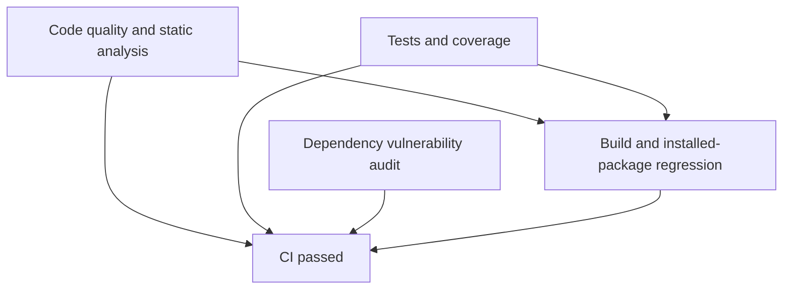

# Development

Use `uv sync --locked --all-extras` and activate `.venv`. Run `python scripts/validate.py` for formatting, lint, typing, tests, coverage, security scans, package build and archive checks. Required failures are not skipped. Dependency auditing requires access to the public vulnerability service.

Run `python -m pytest` for focused tests. Install optional Git hooks with `python scripts/install_hooks.py`, adding `--with-push` for full push validation. Existing unmanaged hooks are preserved. Remove managed hooks with `python scripts/install_hooks.py --uninstall`. Reinstall after moving your virtual environment. Do not combine this installer with another hook manager.

CI runs on a separately managed self-hosted Linux runner with the `datavouch_local` label. The runner must provide Python 3.15.2, uv and actionlint. Runner images and management scripts are maintained outside this repository. Workflows require a private repository, `DATAVOUCH_TRUSTED_RUNNER=true` and the actor configured in `DATAVOUCH_TRUSTED_ACTOR`. Pushes to every branch containing these workflows are validated. The resulting commit checks appear on its pull request. Fork events do not run on the personal runner. Main and new feature branches inherit this configuration after merge; existing branches must incorporate the workflow changes.

The validation script accepts `--stage` for named CI steps and runs every stage by default. Unit, contract and integration stages accumulate coverage in order. Run them in a clean checkout or run the full validator to reset coverage before collecting results. Actionlint 1.7.12 must be on PATH for workflow checks. Test and coverage XML is written to ignored `.ci-artifacts/`.

The credential pattern check detects selected private key and access key formats. It is not an exhaustive secret audit. Bandit inspects runtime source. pip-audit checks installed third party dependencies and explicitly skips the editable DataVouch package, which has no runtime dependencies. Independent security review remains a release requirement.

See [performance methodology](performance.md) for the reproducible local benchmark.

## Visible CI stages

The workflow runs once per branch push, including main, and supports manual dispatch. PRs show the checks attached to their head commit. Opening or updating a PR does not repeat the full pipeline. This validates the pushed head, not GitHub's synthetic merge commit. Update a feature branch with current main before merging when main has changed. The resulting main commit is validated again after merge.

Quality, tests and the dependency audit can run concurrently. Package validation starts after quality and tests, while a slow network audit can finish independently. The final gate requires all four jobs to succeed. Failure, cancellation or a skipped required job cannot pass. Two local runners each limited to one CPU and 2 GB are recommended for the current Docker allocation of three CPUs and about 5.8 GiB. No hosted fallback is configured.

| Check | Purpose |
| --- | --- |
| Formatting, Ruff, mypy, actionlint and Bandit | Consistent formatting, Python and workflow defects, type errors and common source security problems |
| Unit tests | Individual comparison, validation and policy behavior |
| Adapter contract tests | Connector interfaces, provider boundaries and external adapter compatibility |
| Integration and regression tests | CLI exit codes, BigQuery collection through verification, failed-job handling, policy outcomes, viewer authentication and escaping, report replay, packaging checks and Git hooks |
| Coverage | Enforce the 90 percent minimum over the combined suites |
| Dependency audit | Query current vulnerability data for the installed locked dependencies |
| Package build and regression | Prove that an installable distribution works outside the source checkout |

Unit, contract and integration tests remain separately named steps in one job. They share one dependency setup and coverage database. These tests use fixtures and mocks; CI does not contact BigQuery or receive cloud credentials. The local fixture suites take seconds, so parallel jobs and coverage transfers cost more than they save.

The runner image already caches the locked third-party packages. Setup tries `uv sync` offline first and downloads only if the revision needs packages absent from that image. Rebuild the image after lockfile changes to warm the cache once for both runners. No virtual environment or dependency cache is uploaded to GitHub, and passing vulnerability results are not cached.

Build creates a wheel, the installable Python distribution, and a source archive. The same job installs that wheel into a clean virtual environment outside the checkout and checks expected PASS, FAIL and blocked UNKNOWN outcomes, deterministic reports, BigQuery replay and external adapter behavior. One source-archive rebuild checks parity with the already-built wheel. Release metadata and private-file exclusions are also validated. No packages are published or deployed.

Successful runs upload no artifacts. Test XML is retained for three days only when the test job fails; normal logs and the final job summary remain available. Coverage databases, package archives and release inventories are not transferred between jobs. The separate workload example is manual-only because its automatic PASS scenario is already covered by installed-package regression.

The prepared main protection policy requires `CI passed`. GitHub Free does not enforce branch protection for this private repository, so the check reports readiness but cannot disable the merge button. Main adopts this graph after merge; existing branches must incorporate the workflow changes.

## Static analysis tooling

Ruff, mypy and Bandit are the current static checks; pip-audit checks dependencies and coverage measures tests. SonarQube can later add centralized history and quality governance, but it is not needed to run these checks. Its documented small-installation baseline of 4 GB RAM and two cores would compete with the runners and existing containers on this host. Use the official SonarQube image and a separately provisioned database if centralized analysis becomes a requirement, rather than maintaining a custom analyzer image.

## Deployment checks

The code-quality job also runs Helm 4.2.0 lint, schema rejection tests, render/security contracts and chart packaging. On Linux CI the validator downloads the official architecture-specific Helm archive and checks its pinned SHA-256. No cluster credentials or Docker socket are supplied to CI. Local `scripts/check_compose.py` and `scripts/check_kubernetes.py --context YOUR_CONTEXT` exercise actual infrastructure separately; the Kubernetes check creates and removes only its own generated namespace.

## Public contribution CI preparation

The `Public contribution CI` workflow is inactive while the repository is private. After publication it validates pushes and pull requests on disposable standard GitHub-hosted Ubuntu runners, using a read-only token, no cloud credentials and pinned, checksum-verified tools. It installs dependencies once and runs the existing validation stages in one job with separately visible steps. It does not publish releases or upload artifacts.

Before changing visibility, stop the local runner supervisors and unregister this repository's self-hosted runners, including any organization runner access. Workflow conditions alone cannot prevent a contributor from changing a workflow. Set fork workflow approval to all outside collaborators and verify the effective policy. Require `Public CI passed` on main after the first successful hosted run; the private `CI passed` check intentionally stops running in public mode. Configure owner-controlled merges, reviewed changes, and blocked force pushes/deletion using enforceable repository rules. A sole author cannot approve their own pull request.

The public workflow has syntax and trust-boundary tests, but a hosted execution and fork acceptance test are required before it can be declared operational. The owner has authorized the source-only publication transition. The private alpha release writer remains private-only; public release automation needs its own reviewed main-branch permission policy before enablement.
